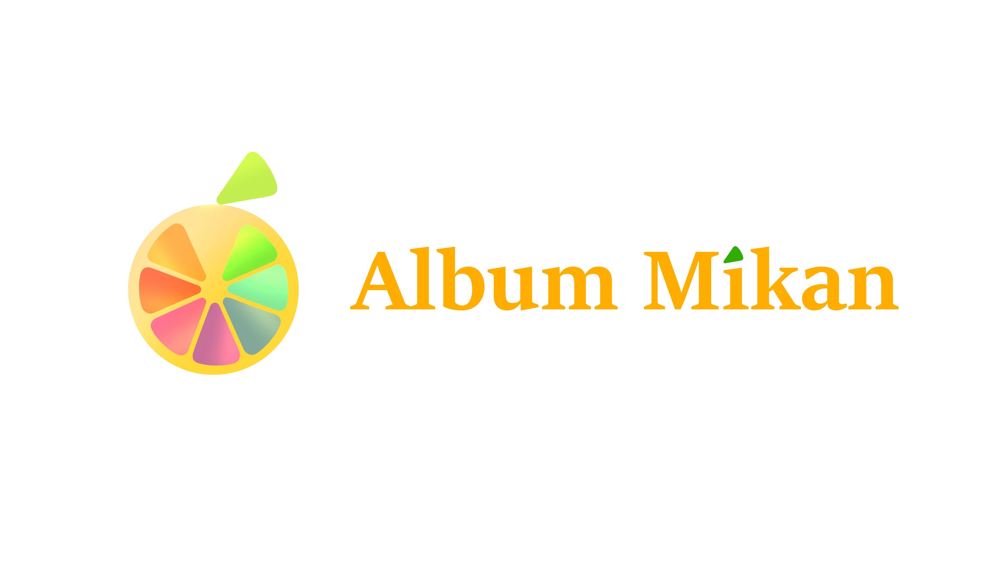
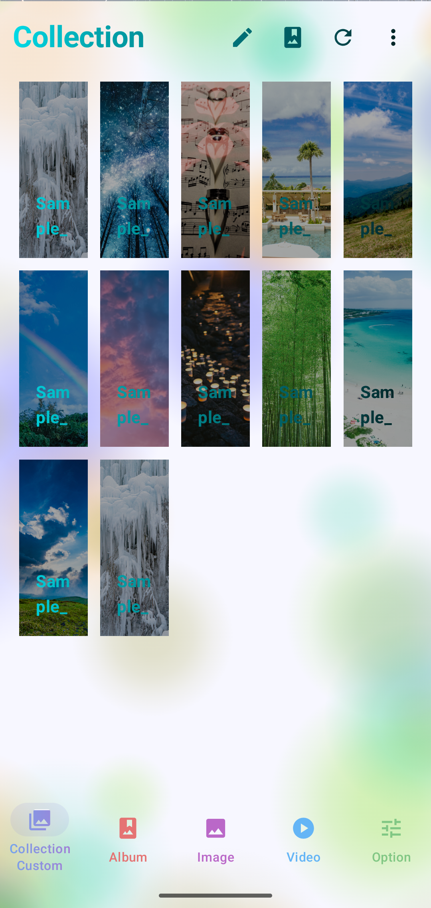
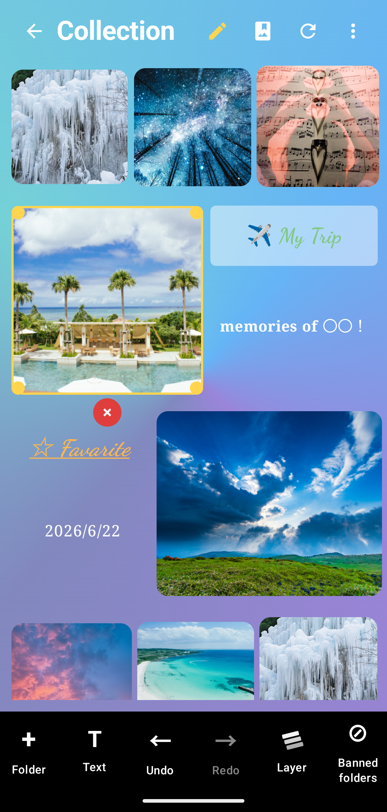
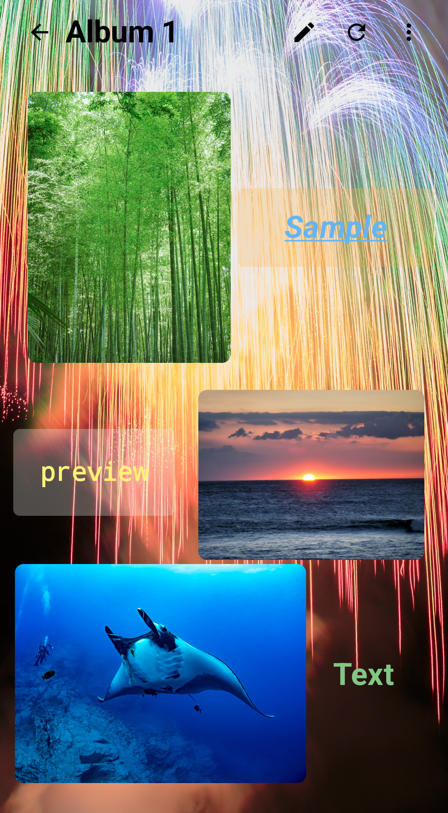
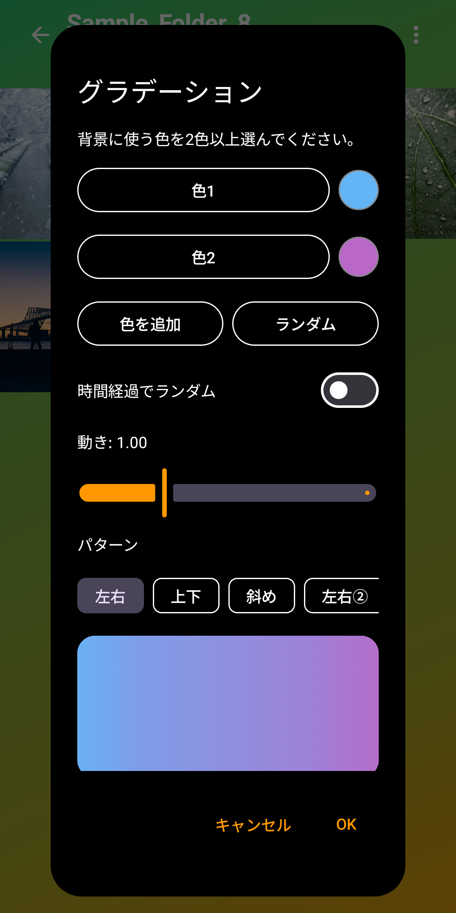

# 🍊 Album Mikan
*— Customize Your Gallery and Album —*

## Overview

**Album Mikan** is a customizable gallery app for Android that allows users to browse, organize, and enjoy their images, videos, and PDF files.

While providing the essential features of a gallery app, Album Mikan focuses on something more: **giving users the freedom to create a gallery that truly feels like their own.**

From colors and backgrounds to folder layouts and custom albums, users can personalize not only how their media is organized, but also how it looks and feels.

Our goal is to combine **extensive customization with a lightweight, smooth, and comfortable user experience.**

## ✨ Features

### 📁 Media Browsing & Organization

Browse and manage your media through a simple and flexible interface.

- Browse images, videos, GIFs, and PDF files.
- Organize and explore media by folder.
- Customize thumbnail sizes, grid columns, and sorting options.
- Zoom, crop, and make simple edits to images.
- Move media to the trash and restore it when needed.
- Hide selected folders and albums from the main gallery.

### 🎨 Custom Collection

**Custom Collection** allows users to go beyond traditional grid-based layouts and create their own gallery spaces.

- Freely position folders and text elements.
- Move, resize, and rotate individual elements.
- Adjust layering and visual styles.
- Customize folder covers, borders, and other visual details.
- Save and reuse custom layouts as presets.

Rather than following a fixed layout, users can arrange their collections in ways that reflect their own preferences and creativity.

### 🖼️ Album Editor

The **Album Editor** provides a creative space for arranging images and text into personalized albums.

- Add images and text to a custom canvas.
- Freely move, resize, and rotate elements.
- Adjust the order of overlapping elements.
- Customize backgrounds and decorations.
- Save, view, and re-edit created albums.

Whether creating a collection of favorite illustrations, a themed photo album, or a personal visual layout, users can enjoy presenting their media in their own style.

### 🌈 Appearance Customization

Album Mikan offers a wide range of appearance settings so users can personalize the entire gallery experience.

- Customize background colors, text colors, and folder card designs.
- Apply gradients, imported images, and GIF textures.
- Adjust the appearance of navigation bars and other interface elements.
- Configure display preferences for different screens.

The aim is to make customization an integral part of the app, rather than a small collection of optional themes.

### ⚙️ Additional Features

- **Vault:** Pattern-based access restrictions for selected features.
- **Exclude:** Hide specific folders or albums without deleting them.
- **Language Support:** Switch between Japanese and English.
- **Display Preferences:** Fine-tune gallery layouts and viewing settings.

## 💡 Inspiration & Background

Album Mikan started with a simple frustration: the gallery app I was using displayed too many ads.

At first, I just wanted to create a simple, ad-free gallery app that I could use comfortably. However, while exploring other gallery apps, I noticed that although many offered excellent tools for browsing and organizing media, relatively few allowed users to freely customize the appearance and layout of their galleries.

This led me to an idea inspired by creative games and applications such as **Minecraft** and **gogh: Focus with Your Avatar**.

What I find especially appealing about these experiences is that they leave room for users to create something of their own. By spending time arranging, decorating, and personalizing a space, users can develop a sense of attachment to what they have created.

I wanted to bring a similar experience to a gallery app.

Instead of simply providing a finished interface, **Album Mikan aims to become a space that users can shape and make their own.**

The idea is simple: a gallery should not only be a place to store and view memories, illustrations, and other media. It can also be a place to express personal style and creativity.

## 🚀 Development & Future Plans

Album Mikan is currently under development. Its core browsing, organization, and customization features have been implemented, and development is continuing with a focus on performance, usability, and stability.

During development, I also received feedback from several testers and used their suggestions and bug reports to improve the app's interface and behavior.

Future development will focus on:

- **Performance:** Improving responsiveness, memory efficiency, and smoothness, especially when handling large media collections or complex layouts.
- **Customization:** Expanding the flexibility of layouts, editing tools, and visual effects.
- **User Experience:** Making advanced customization easier and more intuitive.
- **Stability:** Improving reliability, data management, and overall maintainability.
- **Technology Exploration:** Exploring Flutter and Unity as potential options for future development, with a focus on rendering performance, graphical flexibility, and overall efficiency.

The app is currently built with Kotlin and Jetpack Compose. As part of future development, I plan to experiment with Flutter and Unity, comparing their capabilities with the existing implementation before deciding on the most suitable approach.

The long-term goal remains unchanged:

**To create a lightweight gallery app that offers exceptional freedom of customization without sacrificing everyday usability.**

## 📦 Download

Album Mikan is distributed as an Android APK.

Please note that the app is still under development. Some features may not work as expected depending on the device or Android version.

### Source Code

This public repository is intended for introducing Album Mikan and distributing APK builds.

**The source code is not publicly available.** The development project is maintained separately in a private GitHub repository.

## 🛠️ Development Environment

- **Platform:** Android
- **Language:** Kotlin
- **UI Framework:** Jetpack Compose
- **IDE:** Android Studio

---

*🍊 Album Mikan — Customize Your Gallery and Album.*